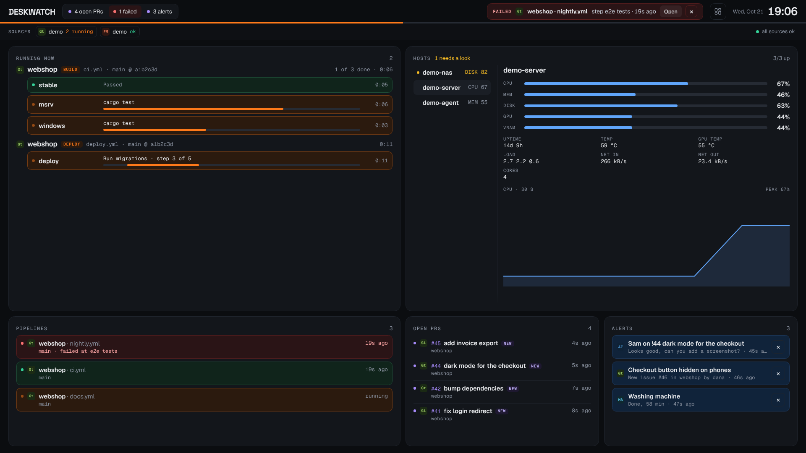

# DeskWatch

**A dashboard for your homelab and your pipelines.** DeskWatch shows what your servers and CI are doing, on one screen:
jobs that are running right now with live progress, failed runs, open pull requests, host stats and alerts from Home
Assistant. Every line says where it comes from, so a glance tells you what runs where.



One small program, the **bridge**, collects the data and serves the dashboard. It runs on Linux, Windows, a Raspberry Pi
or in Docker, and needs no internet beyond the sources you point it at.

## What it shows

- **Running now:** every CI job with its steps, elapsed time and where it runs. A run that just finished well stays for
  a moment as *Done*.
- **Pipelines and pull requests** from Gitea, GitHub (and GitHub Enterprise), GitLab, Bitbucket Cloud and Azure DevOps.
- **Hosts** from Prometheus and the bridge machine itself: CPU, memory, disk, GPU and VRAM (NVIDIA through the DCGM
  exporter, AMD on the bridge machine), uptime, temperature, network. Hosts that
  need a look (down, nearly full, just rebooted) come first.
- **One event at a time in the header:** a failed run or critical alert in red until you dismiss it, a warning in
  yellow, a success (or a *Fixed* after a failure) in green that goes away by itself.
- **Alerts** from Home Assistant or any script, over MQTT or HTTP, and from your Git hosts: a new issue, or a new
  comment on an open Azure DevOps pull request. Info is blue, warning yellow, critical red.
- **Your own layout:** every user hides, moves and resizes panels with the grid icon in the header, kept per user.
- **A setup page** to add sources, test connections and change settings from the browser, and an optional login
  with viewer, operator and administrator roles (passwords, API keys, or sign-in with GitHub or Microsoft).

## Try it in a minute

```sh
git clone https://github.com/Sylentic/DeskWatch.git && cd DeskWatch
docker compose -f deploy/docker-compose.demo.yml up --build     # the first build takes a few minutes
```

Open <http://localhost:8787/> for the dashboard with fake data. Without Docker, with Rust installed:
`cargo run -p deskwatch-bridge -- --demo --kiosk --no-mqtt`.

## Install

| Where | Guide |
|---|---|
| **Docker** on a homelab server (the easiest way to the dashboard; image on `ghcr.io/sylentic/deskwatch-bridge`) | [docs/docker.md](docs/docker.md) |
| **Linux** with systemd (release binaries for x86_64 and aarch64) | [docs/install.md](docs/install.md) |
| **Raspberry Pi** with a monitor or TV as a wall display | [docs/raspberry-pi.md](docs/raspberry-pi.md), [docs/kiosk.md](docs/kiosk.md) |
| **Windows** (release zip, can run as a service) | [docs/windows.md](docs/windows.md) |

Then add your sources, on the [setup page](docs/setup-page.md) or in the config file
([`bridge/config.example.toml`](bridge/config.example.toml)). Secrets never go in the config: they are read from
credential files.

**Keep it on your own network** until you have set a password ([docs/auth.md](docs/auth.md)) and, if it crosses an
untrusted network, HTTPS ([docs/https.md](docs/https.md)). Without a password the dashboard has no login, and the setup
page and `POST /api/alert` only answer the local network.

## Sources

| Source | How | Tested |
|---|---|---|
| Gitea | Webhooks (instant start and end) plus polling for steps and PRs | On a real server |
| GitHub, GitHub Enterprise | Polling with ETags | On real repositories |
| Azure DevOps Services | Polling: runs with stages, approvals, PRs, PR comments, agent pools; sign in with a PAT or a Microsoft Entra service principal ([guide](docs/azure-devops.md)) | On a real organisation |
| GitLab (gitlab.com and self-managed) | Polling: merge requests, pipelines, runners ([guide](docs/gitlab.md)) | Against mock answers only |
| Bitbucket Cloud | Polling: PRs, pipelines, runners ([guide](docs/bitbucket.md)) | Against mock answers only |
| Prometheus | node_exporter and cAdvisor through the HTTP API | On a real server |
| The bridge machine | `/proc` and `/sys` (Linux) | Yes |
| Home Assistant, scripts | Alerts over MQTT or `POST /api/alert` ([guide](docs/home-assistant.md)) | Yes |

Forgejo and Codeberg are not tested; what they and the others need is in [docs/git-hosts.md](docs/git-hosts.md). Gitea,
GitHub, GitLab and Bitbucket can also list their self-hosted runners ([docs/runners.md](docs/runners.md)).

## Status

DeskWatch is at **1.0**: the dashboard, the setup page, the login and the sources above work and run on the author's
homelab. Not done yet:

- The dashboard on a real Raspberry Pi (built and tested in Chromium on a PC), and GitLab and Bitbucket against real
  servers.
- Release binaries for macOS and 32-bit ARM (build from source).

What changed in each version is in the [changelog](CHANGELOG.md).

## Documentation

Everything is in [docs/](docs/README.md): installing, the dashboard and its widgets, the setup page, the login and
HTTPS, each source, alerts and MQTT. Working on DeskWatch itself (running from source, the demo, the checks
before a pull request) is in [docs/development.md](docs/development.md).

## License

Licensed under either of the [Apache License, Version 2.0](LICENSE-APACHE) or the [MIT license](LICENSE-MIT), at your
option. The typefaces in `bridge/fonts/` are under the SIL Open Font License 1.1.
